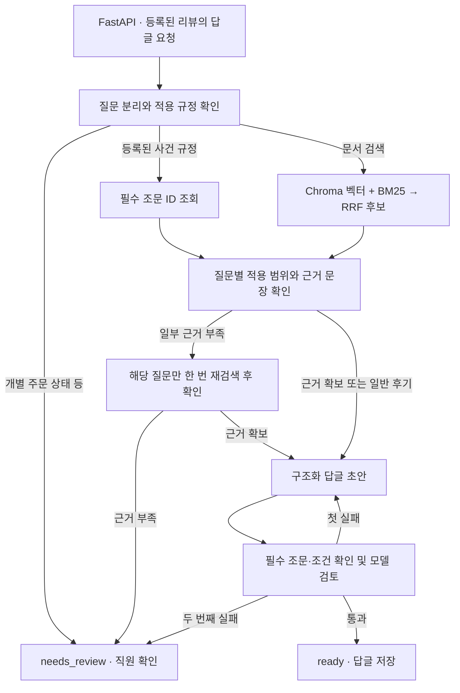

# 오지 레스토랑 리뷰 서버

리뷰에 담긴 질문을 나누고 매장 규정의 근거를 찾은 뒤, 사장님 답글을 작성·검토하는 FastAPI 실습입니다. 통과한 답글은 리뷰에 저장하며 JSON, SSE, 한 문장 수정 경로에서 같은 LangGraph를 사용합니다.

| 검증한 동작 | 초기 → 최종 |
| --- | ---: |
| 35조 규정집 · 필요한 조문을 모두 포함해 저장 | 6/44 → 43/44 |
| 50페이지·155조 규정집 · 새 조문의 번호와 핵심 구절까지 저장 | 0/24 → 24/24 |
| 155조 대리 수령 등 적용 범위 진단 · 번호와 핵심 구절까지 저장 | 5/11 → 11/11 |
| 같은 진단의 실제 상태·대상 불명 문의 · 올바르게 보류 | 2/5 → 5/5 |

[35조 버전별 측정](benchmark/RESULTS.md) · [155조 버전별 측정과 응답 원본](benchmark/scale/VERSIONS.md)

## 로컬 실행

Python 3.14와 uv가 필요합니다. 다음은 Windows PowerShell에서 저장소 루트로 이동해 실행하는 명령입니다.

```powershell
uv sync --locked
uv run --locked python -m app.services.policy_index
$env:FAKE_LLM = 'true'
$env:LANGSMITH_TRACING = 'false'
uv run --locked fastapi run --host 127.0.0.1 --port 8000
```

첫 인덱스 구축 때 다국어 MiniLM 임베딩 모델을 내려받습니다. 기본 앱은 [실습 규정집 35조](data/ohgi_regulations.md)와 `.local/`을 사용합니다. 앱 시작 전에 인덱스를 만들고 규정이 바뀌면 인덱스를 다시 만든 뒤 서버를 재시작합니다. 가짜 모델 모드로 OpenAI 키 없이 전체 흐름을 실행할 수 있습니다.

[Swagger UI](http://127.0.0.1:8000/docs)에서 리뷰 등록·답글 생성·조회·수정을 실행할 수 있습니다. 155조와 제69조 대리 수령은 아래 확장판 재현 명령으로 실행합니다.

## 아키텍처



- **검색** · Chroma는 임베딩으로 의미가 가까운 조문을, BM25는 한국어 단어와 글자 쌍이 겹치는 조문을 찾습니다. 각각 최대 8개 후보를 RRF로 정렬하고, 상위 몇 개 밖에 있는 조문도 직접 근거를 찾을 때 사용합니다. [검색기](app/services/hybrid_retriever.py) · [질문별 검색](app/services/policy_search.py)
- **근거 선택** · ‘포장 음식을 대신 받는다’와 ‘분실물을 대신 받는다’는 행동이 같아도 적용 대상이 다릅니다. 제목과 본문에서 대상을 확인하고, 그 행동의 조건을 설명하는 문장을 고릅니다. 제69조는 질문에 주문번호가 없어도 안내할 수 있습니다. 실제로 누군가 받아 갔는지는 매장 기록이 필요합니다. [문장 선택](app/services/policy_passages.py)
- **작성과 검토** · 그래프는 필요한 조문이 확보됐을 때 초안을 작성합니다. 사건별 필수 안내와 모델의 구조화 판정을 통과하면 `ready`를 반환합니다. 최대 초안 2회, 그래프 단계 한도 8, 비동기 요청 시간 기본 60초입니다. [그래프](app/services/reply_workflow.py)
- **상태** · `InMemorySaver`가 `review:{id}`별 체크포인트를 관리합니다. SQLite Store의 `("stores", "ohgi", "reply")` 네임스페이스에는 매장 말투와 문장 상한을 저장합니다. 설정은 재시작 후 다시 읽으며 리뷰·답글·체크포인트는 메모리에서 초기화됩니다. [앱 초기화](app/main.py) · [답글 서비스](app/services/reply_service.py)

### 실습 1–6단계

| 단계 | 구현 |
| --- | --- |
| 1 | [LCEL 체인](app/clients/llm_client.py)의 `ChatPromptTemplate → ChatOpenAI → StrOutputParser` |
| 2 | [구조화 응답](app/schemas/reply_draft.py)의 Pydantic 초안·검토 스키마 |
| 3 | [LangGraph](app/services/reply_workflow.py)의 `retrieve → draft → review`와 제한된 재작성 |
| 4 | [SSE](app/routers/review_router.py)의 진행·초안 조각·최종 상태 |
| 5 | [체크포인터와 Store](app/main.py)의 리뷰별 상태·매장 선호·답글 수정 |
| 6 | [규정 RAG](app/services/policy_index.py)의 사전 인덱싱, 하이브리드 검색, 질문별 원문 검증 |

## API

| 메서드 | 경로 | 결과 |
| --- | --- | --- |
| POST | `/api/reviews` | 리뷰 등록 201 |
| GET | `/api/reviews`, `/api/reviews/{id}` | 목록과 개별 리뷰 조회 |
| POST | `/api/reviews/{id}/reply` | 구조화 답글 결과 |
| POST | `/api/reviews/{id}/reply/stream` | SSE 진행·초안 조각·최종 결과 |
| POST | `/api/reviews/{id}/reply/revise` | `instruction`으로 직전 저장 답글 수정 |
| POST | `/api/reviews/{id}/reply/sync` | 동기 LCEL 실습 경로 |
| GET, PUT | `/api/reply-preferences` | 매장 말투와 문장 상한 읽기·저장 |

등록 키는 `customerName`(1~20자), `rating`(1~5 정수), `content`(1~500자)입니다. 답글 결과에는 `status`, `reply`, `tone`, `needsFollowup`, `articleIds`, `attempts`가 포함됩니다. `ready`는 저장을 뜻합니다. `needs_review`의 `reply`는 `null`이며 기존 답글을 유지합니다. `needsFollowup`은 매장에서 추가 확인할 내용이 있다는 표시입니다.

404는 없는 리뷰, 409는 같은 리뷰의 처리 중 충돌 또는 수정할 답글이 없는 경우입니다. JSON 경로는 모델 실패를 502로 반환하고 SSE는 전송을 시작한 뒤의 실패를 `error` 이벤트로 보냅니다. `draft_delta`는 임시 텍스트이며 `attempt`가 달라지면 미리보기를 새로 시작합니다. 저장 여부는 `final`에서 확인합니다.

### 복합 리뷰 실습

서버를 실행한 뒤 다른 PowerShell 창에서 실행합니다. 가짜 모델의 두 번째 초안과 한 문장 수정에서 제12조의 24시간과 제17조의 1시간 및 사진 조건을 확인할 수 있습니다.

```powershell
$base = 'http://127.0.0.1:8000'
$body = @{
    customerName = '실습 손님'
    rating = 1
    content = '주문한 메뉴와 다른 음식이 왔고 배달 용기가 깨져 국물이 쏟아졌어요.'
} | ConvertTo-Json
$review = Invoke-RestMethod -Method Post -Uri "$base/api/reviews" `
    -ContentType 'application/json; charset=utf-8' -Body $body
$reviewUrl = "$base/api/reviews/$($review.reviewId)"
curl.exe -N -X POST "$reviewUrl/reply/stream"
Invoke-RestMethod -Uri $reviewUrl
Invoke-RestMethod -Method Post -Uri "$reviewUrl/reply/revise" `
    -ContentType 'application/json; charset=utf-8' `
    -Body (@{ instruction = '한 문장으로 줄여 주세요.' } | ConvertTo-Json)
```

`PUT /api/reply-preferences`에 `{"style":"따뜻","maxSentences":3}`을 보내 매장 선호를 바꿀 수 있습니다. 말투는 `정중` 또는 `따뜻`, 문장 상한은 1~5입니다.

## 벤치마크

### 기본 규정 35조

강의 골든셋 20개를 검색기에 직접 넣었을 때, Chroma 벡터는 Hit@1 **13/20**, Hit@3 **15/20**, BM25는 **14/20**, **20/20**, RRF는 **17/20**, **19/20**이었습니다. 이 세트에서는 RRF가 첫 후보를 더 자주 맞혔고 BM25가 상위 세 후보에서 더 많이 찾았습니다. [평가 명령과 전체 기록](benchmark/RESULTS.md)

답글 API 벤치에서는 44건 중 필요한 조문을 모두 포함해 저장한 수가 6건에서 43건으로 늘었습니다. 남은 G15는 중증 땅콩 알레르기가 있는 손님의 특정 주문 안전 문의입니다. 검색 후보의 제20조는 같은 주방에서 미량이 섞일 수 있다는 일반 근거를 담고 있어, 실제 안전 판단은 매장 확인으로 넘겼습니다. [35조 버전별 수치](benchmark/RESULTS.md) · [제20조 근거 보존 시제품](benchmark/experiments/ANSWERABILITY.md)

### 50페이지·155조 확장판

기존 규정 35조에 가상 규정 120조를 붙였습니다. 시작 버전은 새 조문 24건 중 23건에서 원질문 검색 후보에 정답 근거가 있었지만, 이를 전부 답글에 반영해 저장한 건 0건이었습니다. 질문별 근거를 연결한 뒤 24/24를 저장했고, 적용 범위를 확인하는 버전에서 추가 진단 10/10과 대리 수령 등 변형 11/11을 확인했습니다. 기존 43/44와 확장판 고정 대조군 보류 7/7도 유지했습니다. [규정집 크기 비교](benchmark/scale/RESULTS.md) · [155조 버전별 측정](benchmark/scale/VERSIONS.md)

초기 실행의 35조 인덱스와 임베딩 캐시를 준비한 뒤 아래를 실행합니다. PDF 생성기는 Windows 맑은 고딕을 사용합니다. 확장판 벤치와 HTTP 점검은 선택한 Git 커밋을 임시 경로에 풀어 해당 규정집을 인덱싱합니다.

```powershell
$book = '.local/benchmark/regulations-50p.md'
$version = '5993846'
uv run --no-project --with reportlab python benchmark/scale/render_book.py --markdown $book --pdf .local/benchmark/regulations-50p.pdf
uv run --locked python benchmark/scale/run.py --expanded-only --source-commit $version --markdown $book --output .local/benchmark/router-155.json
uv run --locked python benchmark/scale/run.py --diagnostic-file benchmark/scale/policy-scope.json --source-commit $version --markdown $book --output .local/benchmark/router-155-scope.json
uv run --locked python benchmark/scale/smoke.py --expect-policy-scope --source-commit $version --markdown $book --output .local/benchmark/router-155-http.json
```

## 검증 범위

```powershell
$env:FAKE_LLM = 'true'
$env:LANGSMITH_TRACING = 'false'
uv run --locked pytest -q
```

`5993846`에서 테스트 89개가 통과했습니다. 155조는 실제 Chroma·BM25를 사용한 FastAPI `TestClient`와 로컬 Uvicorn으로 JSON·SSE·수정·재조회·보류를 검증했습니다. 측정의 OpenAI 요청은 0회입니다. 가짜 모델과 개발에 사용한 회귀 문항으로는 실제 모델의 문장 품질, 새로운 사용자 질문의 성능, 운영 지연을 판단할 수 없습니다. [HTTP 점검 원본](benchmark/scale/results/155-5993846-localhost.json)

가짜 모델 로컬 서버를 8000번 포트에 띄운 뒤 `uv run --locked python benchmark/benchmark.py`로 동기·비동기 경로의 지연과 처리량을 비교할 수 있습니다. 두 경로의 작업량은 다릅니다. [리팩토링 전 README와 실제 OpenAI 예시](https://github.com/kodonghui/ohgi-review-server/blob/d13fba9510a31f517b983f933e9348187b87741a/README.md)
