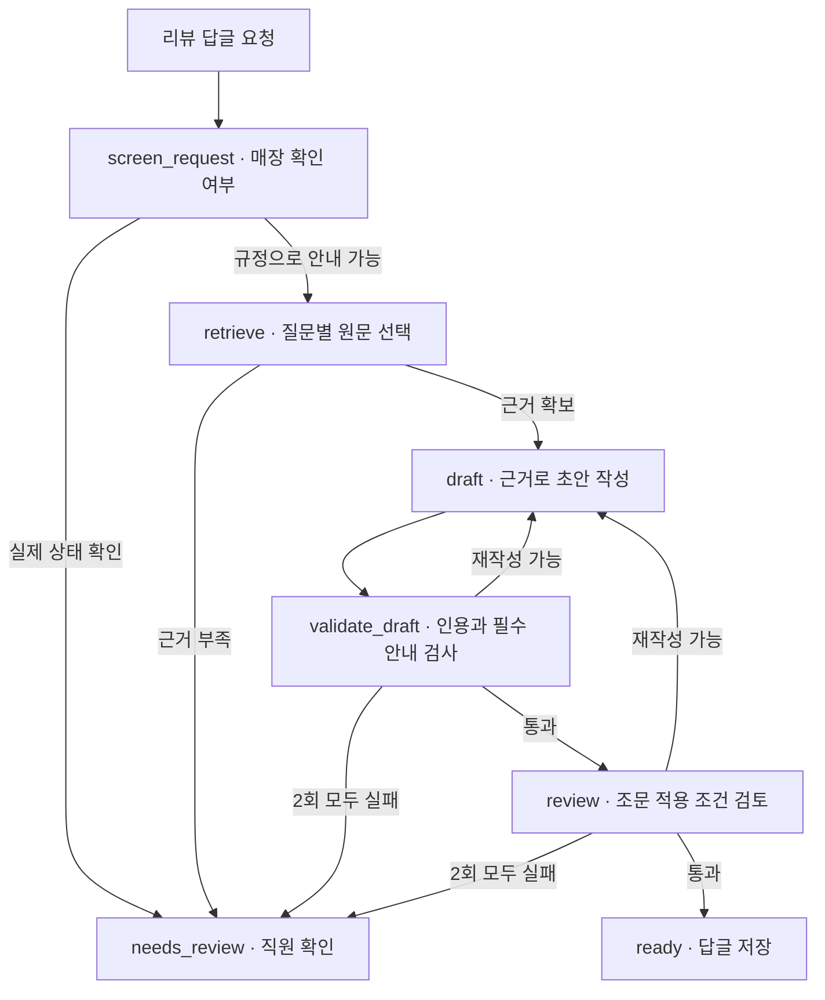

# 오지 레스토랑 리뷰 서버

리뷰에 담긴 질문을 나누고 매장 규정의 근거를 찾은 뒤, 사장님 답글을 작성·검토하는 FastAPI 실습입니다. 통과한 답글은 리뷰에 저장하며 JSON, SSE, 한 문장 수정 경로에서 같은 LangGraph를 사용합니다.

**200페이지 실험의 전체 답글 API는 274/576 → 493/576 통과했고, 오승인은 47 → 0회였습니다.** 같은 32문항을 Chroma와 pgvector에서 GPT·Claude·DeepSeek로 반복했습니다. [200페이지 실험과 재현](#200페이지-벤치마크)

| 과거 35조·155조 실험 | 초기 → 최종 |
| --- | ---: |
| 35조 규정집 · 필요한 조문을 모두 포함해 저장 | 6/44 → 43/44 |
| 50페이지·155조 규정집 · 새 조문의 번호와 핵심 구절까지 저장 | 0/24 → 24/24 |
| 155조 대리 수령 등 적용 범위 진단 · 번호와 핵심 구절까지 저장 | 5/11 → 11/11 |
| 같은 진단의 실제 상태·대상 불명 문의 · 올바르게 보류 | 2/5 → 5/5 |
| 별도 픽업·인계 완료 표현 · 올바르게 보류 | 0/3 → 3/3 |

[이전 벤치마크](#이전-벤치마크) · [35조 실행 기록](benchmark/RESULTS.md) · [155조 실행 기록](benchmark/scale/VERSIONS.md) · [벤치마크 커밋 대조표](benchmark/SOURCES.md)

## 로컬 실행

Python 3.14와 uv가 필요합니다. 다음은 Windows PowerShell에서 저장소 루트로 이동해 실행하는 명령입니다.

```powershell
uv sync --locked
uv run --locked python -m app.services.policy_index
$env:FAKE_LLM = 'true'
$env:LANGSMITH_TRACING = 'false'
uv run --locked fastapi run --host 127.0.0.1 --port 8000
```

기본 앱은 [실습 규정집 35조](data/ohgi_regulations.md)와 `.local/`을 사용합니다. 인덱스 구축과 검색에 OpenAI `text-embedding-3-large`와 `OPENAI_API_KEY`가 필요합니다. 앱 시작 전에 인덱스를 만들고 규정이 바뀌면 인덱스를 다시 만든 뒤 서버를 재시작합니다. `FAKE_LLM`은 답글 작성과 검토에 적용되며 규정 검색의 임베딩 호출은 그대로 사용합니다.

[Swagger UI](http://127.0.0.1:8000/docs)에서 리뷰 등록·답글 생성·조회·수정을 실행할 수 있습니다. 155조와 제69조 대리 수령 측정은 [이전 확장판 결과](benchmark/scale/VERSIONS.md)에서 확인할 수 있습니다.

## 아키텍처



- **검색** · Chroma는 임베딩으로 의미가 가까운 조문을, BM25는 한국어 단어와 글자 쌍이 겹치는 조문을 찾습니다. 각각 최대 8개 후보를 RRF로 정렬하고, 상위 몇 개 밖에 있는 조문도 직접 근거를 찾을 때 사용합니다. [검색기](app/services/hybrid_retriever.py) · [질문별 검색](app/services/policy_search.py)
- **근거 선택** · ‘포장 음식을 대신 받는다’와 ‘분실물을 대신 받는다’는 행동이 같아도 적용 대상이 다릅니다. 제목과 본문에서 대상을 확인하고, 그 행동의 조건을 설명하는 문장을 고릅니다. 제69조는 질문에 주문번호가 없어도 안내할 수 있습니다. 실제로 누군가 받아 갔는지는 매장 기록이 필요합니다. [문장 선택](app/services/policy_passages.py)
- **작성과 검토** · 그래프는 개인의 실제 상태 문의를 먼저 분기합니다. 근거가 확보된 문의의 초안은 인용·필수 안내 코드 검사와 모델 검토를 거쳐 `ready`로 끝납니다. 최대 초안 2회, 그래프 단계 한도 10, 비동기 요청 시간 기본 60초입니다. [그래프](app/services/reply_workflow.py)
- **상태** · `InMemorySaver`가 `review:{id}`별 체크포인트를 관리합니다. SQLite Store의 `("stores", "ohgi", "reply")` 네임스페이스에는 매장 말투와 문장 상한을 저장합니다. 설정은 재시작 후 다시 읽으며 리뷰·답글·체크포인트는 메모리에서 초기화됩니다. [앱 초기화](app/main.py) · [답글 서비스](app/services/reply_service.py)

### 실습 1–6단계

| 단계 | 구현 |
| --- | --- |
| 1 | [LCEL 체인](app/clients/llm_client.py)의 `ChatPromptTemplate → ChatOpenAI → StrOutputParser` |
| 2 | [구조화 응답](app/schemas/reply_draft.py)의 Pydantic 초안·검토 스키마 |
| 3 | [LangGraph](app/services/reply_workflow.py)의 `screen_request → retrieve → draft → validate_draft → review`와 제한된 재작성 |
| 4 | [SSE](app/routers/review_router.py)의 진행·초안 조각·최종 상태 |
| 5 | [체크포인터와 Store](app/main.py)의 리뷰별 상태·매장 선호·답글 수정 |
| 6 | [규정 RAG](app/services/policy_index.py)의 사전 인덱싱, 하이브리드 검색, 질문별 원문 검증 |

## API

| 메서드 | 경로 | 결과 |
| --- | --- | --- |
| POST | `/api/reviews` | 리뷰 등록 201 |
| GET | `/api/reviews`, `/api/reviews/{id}` | 목록과 개별 리뷰 조회 |
| POST | `/api/reviews/{id}/reply` | 구조화 답글 결과 |
| POST | `/api/reviews/{id}/reply/stream` | SSE 진행·초안 조각·최종 결과 |
| POST | `/api/reviews/{id}/reply/revise` | `instruction`으로 직전 저장 답글 수정 |
| POST | `/api/reviews/{id}/reply/sync` | 동기 LCEL 실습 경로 |
| GET, PUT | `/api/reply-preferences` | 매장 말투와 문장 상한 읽기·저장 |

등록 키는 `customerName`(1~20자), `rating`(1~5 정수), `content`(1~500자)입니다. 답글 결과에는 `status`, `reply`, `tone`, `needsFollowup`, `articleIds`, `attempts`가 포함됩니다. `ready`는 저장을 뜻합니다. `needs_review`의 `reply`는 `null`이며 기존 답글을 유지합니다. `needsFollowup`은 매장에서 추가 확인할 내용이 있다는 표시입니다.

404는 없는 리뷰, 409는 같은 리뷰의 처리 중 충돌 또는 수정할 답글이 없는 경우입니다. JSON 경로는 모델 실패를 502로 반환하고 SSE는 전송을 시작한 뒤의 실패를 `error` 이벤트로 보냅니다. `draft_delta`는 임시 텍스트이며 `attempt`가 달라지면 미리보기를 새로 시작합니다. 저장 여부는 `final`에서 확인합니다.

### 복합 리뷰 실습

서버를 실행한 뒤 다른 PowerShell 창에서 실행합니다. 가짜 모델의 두 번째 초안과 한 문장 수정에서 제12조의 24시간과 제17조의 1시간 및 사진 조건을 확인할 수 있습니다.

```powershell
$base = 'http://127.0.0.1:8000'
$body = @{
    customerName = '실습 손님'
    rating = 1
    content = '주문한 메뉴와 다른 음식이 왔고 배달 용기가 깨져 국물이 쏟아졌어요.'
} | ConvertTo-Json
$review = Invoke-RestMethod -Method Post -Uri "$base/api/reviews" `
    -ContentType 'application/json; charset=utf-8' -Body $body
$reviewUrl = "$base/api/reviews/$($review.reviewId)"
curl.exe -N -X POST "$reviewUrl/reply/stream"
Invoke-RestMethod -Uri $reviewUrl
Invoke-RestMethod -Method Post -Uri "$reviewUrl/reply/revise" `
    -ContentType 'application/json; charset=utf-8' `
    -Body (@{ instruction = '한 문장으로 줄여 주세요.' } | ConvertTo-Json)
```

`PUT /api/reply-preferences`에 `{"style":"따뜻","maxSentences":3}`을 보내 매장 선호를 바꿀 수 있습니다. 말투는 `정중` 또는 `따뜻`, 문장 상한은 1~5입니다.

## 200페이지 벤치마크

실험은 2026년 11월 17~18일(KST)에 실행했습니다. 전체 답글 API는 **274/576 (47.57%) → 493/576 (85.59%), +38.02%p**였고, 담당자 확인 문항의 잘못된 자동 승인은 **47 → 0회**였습니다. 기준 실행과 재설계가 사용한 답글 구현은 공개 이력에서 각각 확인할 수 있습니다. [기준 코드](https://github.com/kodonghui/ohgi-review-server/commit/cd16495b4bfbef300c1bba86334f8db6ee8eda5b) · [재설계 코드](https://github.com/kodonghui/ohgi-review-server/commit/ae77bb75f00781b281758ae274299d422577c724)

### 실험 조건과 채점 기준

| 항목 | 설정 |
| --- | --- |
| 규정집 | 200페이지·605조. 제1~155조를 보존하고 실험용 가상 조문 450개 추가 |
| 임베딩 | 조문 제목과 본문을 조문당 하나의 문서로 구성. OpenAI `text-embedding-3-large`, 3,072차원. 같은 문서 벡터를 두 환경에 사용 |
| 검색 저장소 | Windows 노트북의 Chroma 1.5.9 코사인 HNSW와 OVH 싱가포르의 PostgreSQL 16.15·pgvector 0.6.0 코사인 전수 검색 |
| 골든셋 | 가상 규정으로 작성한 리뷰와 예상 상태·필수 조문·안내 문구 32건. 조문이 필요한 24건과 담당자 확인·일반 후기 8건 |
| 교재 검색 실험 | 저장소 2개 × k 2개 × 문항 32개 = **128회**. GPT가 답변하고 같은 GPT 설정으로 답변을 채점 |
| 전체 API 반복 | 저장소 2개 × 모델 3개 × 문항 32개 × 반복 3회 = **576회**. 모델·저장소 조합마다 최대 동시 실행 2건 |
| 모델과 캐시 | GPT `gpt-6-luna`는 `prompt_cache_key`, Claude `claude-haiku-5-5`는 시스템 프롬프트 캐시, 100mil DeepSeek `deepseek-v4.1-flash-free`는 모델 호출당 180초 |
| 채점 | 같은 FastAPI 앱을 `TestClient`로 호출. 리뷰 등록 → 답글 요청 → 저장 결과 재조회. 기대 상태·필수 조문·안내 문구·저장값 대조를 모두 만족하면 통과 |

골든셋의 한 문항은 리뷰 본문과 채점 기준을 함께 담습니다. 예를 들어 M01은 `ready`, 제1조와 제6조, 브레이크타임과 포장 주문 채널 안내가 모두 필요합니다. H01은 `needs_review`, 빈 인용과 저장 답글 대조가 통과 조건입니다. [골든셋 JSON](data/langsmith_reply_golden_200_v1.json) · [채점기와 API 호출](benchmark/langsmith_eval.py) · [LangSmith 평가 개념](https://docs.langchain.com/langsmith/evaluation-concepts)

### 검색 개수 k의 영향

`k`는 첫 벡터 검색에서 가져오는 조문 개수입니다. 검색 적중은 **필수 조문을 모두 찾은 문항 수**입니다. 답변 정확은 GPT 평가로 확인한 32개 답변의 결과입니다. 이 교재 경로는 아래의 하이브리드 API 검색과 별도 측정입니다.

| 환경 | k | 필수 조문 적중 | 답변 정확 전 → 후 | 전후 검색 순서 일치 | 재실험 비용 |
| --- | --- | --- | --- | --- | --- |
| 노트북 Chroma | 1 | 13/24 | 20/32 → 21/32 | 32/32 | 0.00325977 USD |
| 노트북 Chroma | 3 | 17/24 | 24/32 → 24/32 | 32/32 | 0.00403087 USD |
| OVH pgvector | 1 | 13/24 | 21/32 → 21/32 | 32/32 | 0.00326607 USD |
| OVH pgvector | 3 | 17/24 | 24/32 → 24/32 | 32/32 | 0.00399797 USD |

같은 k에서 양쪽 저장소와 전후 버전의 조문 순서가 32문항 모두 일치했습니다. k=1에서는 두 조문이 필요한 문항의 두 번째 근거를 가져올 수 없습니다. k=3에서 적중이 13/24 → 17/24로 늘었습니다. 전체 API는 BM25와 벡터 검색의 순위를 RRF로 합치고, 질문별로 필요한 원문을 확인합니다. [교재 검색과 전체 API 실행 코드](benchmark/scale/eval_200.py) · [질문별 검색 코드](app/services/policy_search.py)

### 전체 답글 API의 점수·시간·비용

| 환경 | 모델 | 통과 전 → 후 | 3회 모두 통과 전 → 후 | 응답 p50 전 → 후 | 재실험 비용 |
| --- | --- | --- | --- | --- | --- |
| 노트북 Chroma | GPT | 49/96 → 85/96 | 16/32 → 26/32 | 3.47초 → 3.73초 | 0.01687674 USD |
| 노트북 Chroma | Claude | 50/96 → 90/96 | 16/32 → 29/32 | 3.66초 → 3.18초 | 0.02380155 USD |
| 노트북 Chroma | 100mil DeepSeek | 37/96 → 70/96 | 8/32 → 15/32 | 87.54초 → 72.84초 | 0.00048087 USD |
| OVH pgvector | GPT | 50/96 → 86/96 | 16/32 → 26/32 | 3.37초 → 3.71초 | 0.01492863 USD |
| OVH pgvector | Claude | 50/96 → 90/96 | 15/32 → 29/32 | 3.61초 → 3.17초 | 0.01735785 USD |
| OVH pgvector | 100mil DeepSeek | 38/96 → 72/96 | 5/32 → 19/32 | 90.25초 → 76.54초 | 0.00048087 USD |

**3회 모두 통과**는 32개 문항 중 세 번의 결과가 모두 채점 조건을 만족한 문항 수입니다. **p50**은 답글 POST 요청을 짧은 순서로 놓았을 때의 중앙값입니다. GPT·Claude 두 모델 합계는 **199/384 → 351/384**였습니다. 각 환경에서 Claude는 90/96과 29/32로 가장 높았습니다. [세부 결과와 p95](benchmark/scale/REDESIGN_RESULTS_200.md)

재실험 사용량 환산액 **0.08866034 USD**은 전체 API 0.07392652 USD, 교재 검색·답변·평가 0.01455468 USD, 사전 검색 검증 0.00017914 USD의 합계입니다. 전체 API끼리는 0.09139846 USD → 0.07392652 USD로 19.1% 감소했습니다. 공통 문서 벡터를 재사용했고, 사용량에는 모델 입출력·캐시와 질의 임베딩을 반영했습니다. DeepSeek는 무료 할당량을 사용했으며 표의 실측 비용은 질의 임베딩입니다. 서버 이용료와 LangSmith 요금은 별도입니다. [비용 산정 코드](benchmark/scale/eval_200.py) · [단가와 기준 사용량 기록](benchmark/scale/RESULTS_200.md)

### 점수를 높인 변경

1. **실제 상태 확인을 작성 전에 분기했습니다.** `screen_request`가 특정 계정의 적립, 입금, 수령 완료를 확인해야 하면 `needs_review`로 종료합니다. GPT·Claude 트레이스에서 해당 요청을 모델 호출 전에 넘긴 비율은 **36/84 → 84/84**였습니다. [분기 코드](app/services/reply_workflow.py) · [상태 표현 분류](app/services/policy_topics.py)
2. **복합 질문을 나눠 근거를 선택했습니다.** `retrieve`는 문장과 절의 요청을 나누고 적용 대상을 확인합니다. 후보가 충분하지 않으면 해당 질문만 다시 검색하고, 적용 범위가 맞는 조문 간 명시적 참조를 한 단계 확인합니다. 초안 전 필수 조문을 확보한 GPT·Claude 요청은 **168/288 → 288/288**이었습니다. [검색과 명시적 참조 추적](app/services/policy_search.py) · [본문 구절 선택](app/services/policy_passages.py)
3. **코드 검사와 의미 검토를 순서대로 실행합니다.** `validate_draft`는 누락된 조문 ID, 확인하지 않은 인용, 필수 안내, 직원 후속 확인 표시와 보상 약속을 검사합니다. `review`는 해당 질문에 조문의 적용 조건을 맞게 설명했는지 평가합니다. 실패 사유는 다음 초안에 전달하며 최대 두 번 작성합니다. [그래프 노드](app/services/reply_workflow.py) · [작성·검토 프롬프트](app/clients/llm_client.py)

| 문항 | 전 → 후 | 실행에서 확인한 내용 |
| --- | ---: | --- |
| M01 · 오후 4시 식사와 전화 포장 | 0/18 → 16/18 | 기준 검색은 제2조와 제6조를 전달했습니다. 식사와 포장을 나누자 제1조의 브레이크타임과 제6조의 앱·홈페이지 주문을 모두 반영했습니다. “전화가 아닌” 표현을 기존 정규식 채점이 인정하지 않은 답글도 있었습니다. |
| H01 · 실제 포인트 적립 확인 | 2/18 → 18/18 | 계정에 반영됐는지는 매장 기록을 확인해야 하므로 검색과 초안 전에 담당자에게 넘겼습니다. |
| M04 · 포인트 신청과 장애 예외 기한 | 0/18 → 18/18 | 일상 접수의 제110조와 장애 예외의 제381조를 별도 근거로 반영했습니다. |
| O05 · 매장 안 포장 대리 수령 | 0/18 → 9/18 | 제201조가 가리키는 제69조의 주문번호 전달 조건을 확인했습니다. 답변 문장의 표현이 채점 정규식과 달라 점수를 잃은 사례가 있었습니다. |
| O07 · 앱의 포인트 변경 내역 | 0/18 → 0/18 | 제112조를 인용하고도 날짜와 주문번호 문장만 발췌해 앱의 확인 경로 안내를 빠뜨린 사례가 남았습니다. |

[해석] 교재 검색 결과의 순서가 유지되는 동안 작성 전에 전달한 근거와 담당자 분기의 결과가 달라졌습니다. 개선 폭은 라우팅·근거 선택·검토 프롬프트를 함께 바꾼 결과입니다. 32문항은 설계에도 활용한 회귀 평가이며, 문구의 뜻을 같은 것으로 봐야 하는 답변도 고정 정규식으로 비교했습니다. 과거 35조에서 기록한 43/44는 가짜 작성·검토 모델과 조문 포함 저장을 사용한 별도 실험입니다. [설계와 비교 범위](benchmark/scale/REDESIGN_200.md) · [35조 실행 기록](benchmark/RESULTS.md)

### 재현

[200페이지 평가 노트북](17_ohgi_review_langsmith_200p.ipynb)과 [가상 조문 생성기](benchmark/scale/render_200.py), [문서 임베딩·인덱스 코드](benchmark/scale/index_200.py)를 사용합니다. 다음 명령은 저장소 루트의 PowerShell에서 실행합니다. 먼저 자신의 `OPENAI_API_KEY`, `ANTHROPIC_API_KEY`, `DEEPSEEK_RELAY_API_KEY`, `LANGSMITH_API_KEY`를 환경 변수에 설정합니다. 임베딩 구축과 모델 평가 명령에서는 API 사용량이 발생합니다.

```powershell
uv sync --locked --group evaluation
uv run --locked --group evaluation python -m benchmark.scale.render_200
uv run --locked --group evaluation python -m benchmark.scale.index_200 embed
$env:OHGI_CODE_COMMIT = (git rev-parse HEAD).Trim()
uv run --locked --group evaluation python -m benchmark.scale.eval_200 chroma dataset
$dataset = '<위 명령이 표시한 dataset_id>'
uv run --locked --group evaluation python -m benchmark.scale.eval_200 chroma lesson --variant graph-v2 --dataset-id $dataset
uv run --locked --group evaluation python -m benchmark.scale.eval_200 chroma api --variant graph-v2 --dataset-id $dataset
```

pgvector 실험은 별도로 준비한 PostgreSQL 인스턴스의 `postgres` DB에 `vector` 확장을 활성화합니다. 위에서 생성한 규정 Markdown·`vectors.npy`·`vector-bundle.json`을 새 실행 환경의 `.local/ohgi-200p/`에 두고, 포트 46581과 `OHGI_PGHOST`의 소켓 위치를 설정합니다. 같은 `dataset_id`를 입력하고 벤치마크 명령에서 `chroma`를 `pgvector`로 바꿉니다. 양쪽 시점의 결과 JSON과 사용량 기록이 있으면 [비교 집계 코드](benchmark/scale/compare_200.py)로 표를 재계산할 수 있습니다.

재설계는 회귀 테스트 100건을 통과했습니다. 재실험 704건(교재 128 + 전체 API 576)을 LangSmith의 10개 실험과 대조했습니다. OVH에서는 결과 파일을 회수한 뒤 실험용 데이터베이스와 임시 자료를 정리했습니다.

## 이전 벤치마크

아래 35조·155조 실험은 Windows의 FastAPI `TestClient`에서 문항별로 3회씩 순차 실행했습니다. `POST /reply`가 반환한 답글과 `GET /api/reviews/{id}`에서 읽은 저장값을 대조했습니다. 기존 44문항은 필요한 조문 번호가 전부 있는지, 확장판의 새 24문항은 핵심 구절까지 답글에 포함했는지 확인했습니다. p50과 p95는 `POST /reply` 지연의 중앙값과 95번째 백분위입니다.

### 검색기 비교 · 강의 골든셋 20문항

Hit@1은 첫 후보, Hit@3은 상위 세 후보에 정답 조문이 들어온 문항 수입니다.

| 검색기 | Hit@1 | Hit@3 |
| --- | ---: | ---: |
| Chroma 벡터 | 13/20 | 15/20 |
| BM25 | 14/20 | 20/20 |
| 하이브리드 RRF | 17/20 | 19/20 |

검색기 단독 평가 명령은 `uv run --locked python -m app.services.policy_index --evaluate`입니다.

### 기본 규정 35조 · 답글 API의 개선 과정

같은 35조 규정집과 같은 52문항으로 코드 5개를 비교했습니다. 조문 평가 대상은 44문항이며 그중 8건이 복합 문의입니다.

| 변경 · 소스와 원본 | 필수 조문 확보 | 필수 조문 포함 저장 | 복합 문의 저장 | 조문 누락 저장 | API p50 / p95 (ms) |
| --- | ---: | ---: | ---: | ---: | ---: |
| 기준 [`f678b2c`](benchmark/results/baseline.json) | 7/44 | 6/44 | 1/8 | 36건 | 4.55 / 16.86 |
| 질문마다 근거 확인 [`414f3af`](benchmark/results/question-routing.json) | 36/44 | 36/44 | 4/8 | 0건 | 13.58 / 25.76 |
| 근거가 부족한 질문만 재검색 [`d016d1c`](benchmark/results/evidence-retry.json) | 43/44 | 43/44 | 8/8 | 0건 | 13.80 / 24.08 |
| 사건별 안내 검증 [`cbd8239`](benchmark/results/verified-notices.json) | 43/44 | 43/44 | 8/8 | 0건 | 16.22 / 27.79 |
| 개별 상태·부정 표현 보완 [`a189167`](benchmark/results/routing-corrections.json) | 43/44 | 43/44 | 8/8 | 0건 | 16.99 / 30.84 |

- **조문이 빠진 저장 36건 → 0건.** 질문을 나누고 각각의 근거를 요구했습니다. 매장 확인이 필요한 7건 중 잘못 저장하던 5건도 보류했습니다.
- **복합 문의 저장 4/8 → 8/8.** 52건 중 7건에서 근거가 부족한 하위 질문만 다시 검색했습니다. ‘맥주도 배달돼?’는 처음 RRF 상위 3개에서 빠진 제18조를 넓힌 후보에서 찾아 답글에 반영했습니다.
- **사건별 안내 검증.** 오배송 접수 24시간과 용기 파손 접수 1시간을 서로 바꿔 쓴 초안은 초기 버전에서 검토를 통과해 저장됐습니다. 사건별 검증을 추가하자 초안 두 번이 모두 걸렸고 기존 답글을 유지했습니다. 개별 상태와 부정 표현을 보완한 버전에서는 실제 환불 입금 문의를 직원 확인으로 보내고, 오배송이 없었다는 파손 신고에는 제17조만 적용했습니다.

43/44에서 남은 G15는 중증 땅콩 알레르기가 있는 손님의 주문 안전 문의입니다. 특정 주문의 안전 판단은 직원 확인으로 보냈습니다. 제20조 원문을 보류 상태에 붙이는 별도 시제품은 **근거 확보 44/44, 답글 저장 43/44**였습니다. [35조 상세 기록](benchmark/RESULTS.md) · [제20조 시제품](benchmark/experiments/ANSWERABILITY.md)

### 같은 코드로 9페이지·35조와 50페이지·155조 비교

기존 35조에 가상 규정 120조를 더하고, 같은 코드 `b3c7dba`에 같은 기존 문항을 넣었습니다. 검색 순위와 후보 합집합은 원질문을 한 번 검색했을 때 필요한 조문을 전부 찾은 건수입니다.

| 기존 문항의 지표 | 9페이지·35조 | 50페이지·155조 |
| --- | ---: | ---: |
| Chroma 상위 3개 | 33/44 | 28/44 |
| BM25 상위 3개 | 40/44 | 31/44 |
| 하이브리드 RRF 상위 3개 | 38/44 | 33/44 |
| Chroma·BM25 전체 후보 합집합 | 44/44 | 40/44 |
| 답글 API의 필수 조문 포함 저장 | 43/44 | 43/44 |
| 재검색이 발생한 요청 | 7/52 | 10/52 |
| 답글 API p50 / p95 (ms) | 13.07 / 24.39 | 14.53 / 26.28 |
| 인덱스 구축 시간 | 2.54초 | 8.41초 |

35조에서는 BM25가 상위 3개에 필요한 조문을 가장 자주 넣었고, 155조에서는 RRF가 가장 자주 넣었습니다. 후보 합집합의 확보 건수가 44/44에서 40/44로 내려갔을 때도, API는 질문별 근거 확인과 재검색을 통해 43/44를 저장했습니다. 35조의 별도 검색 실험에서 로컬 cross-encoder로 후보를 재정렬하면 상위 3개에서 42/44를 확보했고, 재정렬에 중앙값 767.4ms가 추가됐습니다. 현재 API는 두 검색기의 후보를 유지하고, 필요한 조문을 질문별로 확인해 빠진 질문만 다시 검색합니다. [규정집 크기 비교](benchmark/scale/RESULTS.md) · [재정렬 실험](benchmark/RESULTS.md#하이브리드와-재정렬을-고른-근거)

### 50페이지·155조 · 고정 84문항의 버전 비교

같은 155조에서 코드만 바꿨습니다. 기존 52문항에 새 조문 단독 18건, 기존·새 조문을 함께 묻는 6건, 규정만으로 답할 수 없는 7건, 일반 후기 1건을 더한 시험지입니다.

| 변경 | 소스·문항별 원본 | 기존 필수 조문 포함 저장 | 새 조문·핵심 구절 저장 | 대조군 보류 | 새 조문 API p50 / p95 (ms) |
| --- | --- | ---: | ---: | ---: | ---: |
| 기존 규칙 라우터 | [`94cc0df`](benchmark/scale/results/155-ce33186.json) | 43/44 | 0/24 | 3/7 | 7.38 / 41.78 |
| 상태·비공개 문의 보류 | [`a3f111a`](benchmark/scale/results/155-cc0b0aa.json) | 43/44 | 0/24 | 7/7 | 7.93 / 41.24 |
| 새 조문 원문 선택 | [`9038d9a`](benchmark/scale/results/155-2a4a8fb.json) | 43/44 | 24/24 | 7/7 | 28.65 / 75.87 |
| 겹치는 질문 보완 | [`2695f60`](benchmark/scale/results/155-83a8774.json) | 43/44 | 24/24 | 7/7 | 49.74 / 117.57 |
| 조문의 적용 대상과 조건 확인 | [`c6f0fb0`](benchmark/scale/results/155-5993846.json) | 43/44 | 24/24 | 7/7 | 31.04 / 73.78 |
| 픽업·인계 완료 상태 확인 | [`c7052de`](benchmark/scale/results/155-c7052de.json) | 43/44 | 24/24 | 7/7 | 53.51 / 120.97 |

- **검색 후보에 근거 23/24, 초기의 새 조문·구절 저장 0/24.** 지하 주차장에서 휠체어로 이동할 수 있는 경로를 물었을 때, 기존 라우터는 제36조를 후보에 두고도 ‘주차’라는 표현에 따라 제4조의 주차 요금을 저장했습니다. 질문에 직접 답하는 구절을 찾도록 바꾼 뒤에는 제36조의 A구역 승강기를 안내했습니다.
- **새 조문 단독 18/18, 복합 문의 6/6.** 유아 의자·예약 지연·주류 배달·배달 마감을 함께 물은 S24에서 원질문 검색만으로는 네 조문이 다 나오지 않았습니다. 하위 질문별로 근거를 대조하고 빠진 근거를 보완해 제37·49·18·15조를 모두 반영했습니다. 조문이 빠진 채 저장한 새 문항은 3건에서 0건으로 줄었습니다.
- **대조군 보류 3/7 → 7/7.** 실제 환불 입금 여부, 차량 주차 지원 등록, 분실물 습득 여부, 관리자 암호처럼 규정집으로 확인할 수 없는 요청을 보류했습니다. 일반 감사 후기는 여섯 버전에서 모두 답글을 저장했습니다.

초기 두 버전은 새 조문 요청 24건 중 21건을 초안 전에 보류했습니다. 이후 버전은 근거 확인부터 작성·검토·저장까지 처리했고, 최종 버전의 새 조문 API 지연은 **p50 53.51ms, p95 120.97ms**였습니다. 한 PC에서 순차 실행한 값입니다. [155조 실험 조건과 문항](benchmark/scale/VERSIONS.md)

### 고정 문항 24/24 이후 발견한 실패

| 진단 세트 | 소스·문항별 원본 | 조문·핵심 구절 저장 | 올바른 보류 |
| --- | --- | ---: | ---: |
| 추가 14문항 | [`94cc0df`](benchmark/scale/results/155-ce33186-diagnostic.json) | 0/10 | 3/4 |
| 추가 14문항 | [`9038d9a`](benchmark/scale/results/155-2a4a8fb-diagnostic.json) | 7/10 | 4/4 |
| 추가 14문항 | [`2695f60`](benchmark/scale/results/155-83a8774-diagnostic.json) | 9/10 | 4/4 |
| 추가 14문항 | [`c6f0fb0`](benchmark/scale/results/155-5993846-diagnostic.json) | 10/10 | 4/4 |
| 추가 14문항 | [`c7052de`](benchmark/scale/results/155-c7052de-diagnostic.json) | 10/10 | 4/4 |
| 적용 범위·상태 16문항 | [`2695f60`](benchmark/scale/results/155-83a8774-scope.json) | 5/11 | 2/5 |
| 적용 범위·상태 16문항 | [`c6f0fb0`](benchmark/scale/results/155-5993846-scope.json) | 11/11 | 5/5 |
| 적용 범위·상태 16문항 | [`c7052de`](benchmark/scale/results/155-c7052de-scope.json) | 11/11 | 5/5 |
| 픽업·인계 완료 4문항 | [`c6f0fb0`](benchmark/scale/results/155-c6f0fb0-pickup-state.json) | 1/1 | 0/3 |
| 픽업·인계 완료 4문항 | [`c7052de`](benchmark/scale/results/155-c7052de-pickup-state.json) | 1/1 | 3/3 |

- **한 요청의 두 예약 질문.** 기존에는 단체 예약 제30조만 답했습니다. 각각의 질문을 유지한 뒤 단체 메뉴 제출 기한인 전날 오후 6시(제51조)와 일반 2인 예약 가능 기간인 다음 14일(제48조)을 함께 저장했습니다.
- **포장과 분실물의 대리 수령.** 제69조는 이미 후보에 있었지만 조건 문장의 점수가 분실물 제43조와 비슷해 보류됐습니다. 조문 전체에서 대상을 확인하고 조건 문장을 고르도록 바꿨습니다. 질문에 주문번호를 적지 않아도 제69조의 주문번호 전달 조건을 안내하고, 분실물에는 제43조의 이름 확인을 안내합니다. 16문항에서 실제 상태를 확인해야 할 문의를 잘못 저장한 건은 3건에서 0건으로 줄었습니다.
- **‘픽업해도 되나요?’와 ‘이미 픽업했나요?’.** 별도 진단의 일반 조건 1건에는 제69조를 붙여 저장했습니다. 픽업이나 인계가 실제 완료됐는지 묻는 3건은 초안 작성 전에 보류했습니다.

### 벤치마크 재현

기본 35조 인덱스와 임베딩 캐시를 준비한 상태에서 실행합니다.

```powershell
uv run --locked python benchmark/policy_quality.py --output .local/benchmark/policy-35.json
```

50페이지 PDF 생성기는 Windows 맑은 고딕을 사용합니다. 아래 확장판 벤치와 HTTP 점검 명령은 MiniLM으로 측정한 과거 실행 기록입니다. 현재 OpenAI 환경에서 새 평가는 [LangSmith 노트북](17_ohgi_review_langsmith.ipynb)으로 실행합니다.

```powershell
$book = '.local/benchmark/regulations-50p.md'
$version = 'c7052de'
uv run --no-project --with reportlab python benchmark/scale/render_book.py --markdown $book --pdf .local/benchmark/regulations-50p.pdf
uv run --locked python benchmark/scale/run.py --expanded-only --source-commit $version --markdown $book --output .local/benchmark/router-155.json
uv run --locked python benchmark/scale/run.py --diagnostics-only --source-commit $version --markdown $book --output .local/benchmark/router-155-diagnostics.json
uv run --locked python benchmark/scale/run.py --diagnostic-file benchmark/scale/policy-scope.json --source-commit $version --markdown $book --output .local/benchmark/router-155-scope.json
uv run --locked python benchmark/scale/run.py --diagnostic-file benchmark/scale/pickup-state.json --source-commit $version --markdown $book --output .local/benchmark/router-155-pickup.json
uv run --locked python benchmark/scale/smoke.py --expect-policy-scope --source-commit $version --markdown $book --output .local/benchmark/router-155-http.json
```

## 검증 범위

```powershell
$env:FAKE_LLM = 'true'
$env:LANGSMITH_TRACING = 'false'
uv run --locked pytest -q
```

`c7052de`에서 테스트 92개가 통과했습니다. 155조는 실제 Chroma·BM25를 사용한 FastAPI `TestClient`와 로컬 Uvicorn으로 JSON·SSE·수정·재조회·보류를 검증했습니다. 측정의 OpenAI 요청은 0회입니다. 실제 모델의 문장 품질, 새로운 사용자 질문의 성능, 운영 지연은 별도 평가가 필요합니다. [HTTP 점검 원본](benchmark/scale/results/155-c7052de-localhost.json)

가짜 모델 로컬 서버를 8000번 포트에 띄운 뒤 `uv run --locked python benchmark/benchmark.py`로 동기·비동기 경로의 지연과 처리량을 비교할 수 있습니다. 두 경로의 작업량은 다릅니다. [리팩토링 전 README와 실제 OpenAI 예시](https://github.com/kodonghui/ohgi-review-server/blob/d13fba9510a31f517b983f933e9348187b87741a/README.md)
