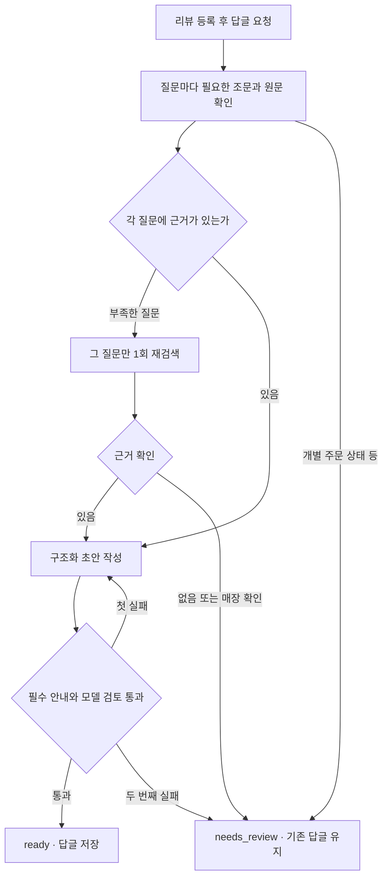

# 오지 레스토랑 리뷰 서버 버전별 벤치마크

2026-11-13 · `refactor-langchain` · 같은 규정과 시험지로 Git 커밋 5개 비교

**필수 조문을 모두 가져온 요청은 7/44 → 43/44, 필수 조문을 모두 표시해 답글을 저장한 요청은 6/44 → 43/44로 늘었습니다.** 사건별 검증을 넣은 뒤부터는 기한을 맞바꾼 초안이 두 번 작성돼도 기존 답글을 유지합니다.

## 1. 변경별 결과

| 변경 | 측정한 소스 | 필수 조문 검색 | 필수 조문을 표시해 저장 | 복합 8문항 저장 | 재검색 요청 | API p50 / p95 (ms) |
| --- | --- | ---: | ---: | ---: | ---: | ---: |
| 기준 · 기존 리뷰 서버 | `1fa6121` · [실행값](results/baseline.json) | 7/44 | 6/44 | 1/8 | 0 | 4.55 / 16.86 |
| 질문별 근거 확인 | `8ed5cf2` · [실행값](results/question-routing.json) | 36/44 | 36/44 | 4/8 | 0 | 13.58 / 25.76 |
| 부족한 질문만 재검색 | `46c35f1` · [실행값](results/evidence-retry.json) | 43/44 | 43/44 | 8/8 | 7 | 13.80 / 24.08 |
| 사건별 안내 검증 | `e9959b1` · [실행값](results/verified-notices.json) | 43/44 | 43/44 | 8/8 | 7 | 16.22 / 27.79 |
| 개별 상태·부정 표현 보완 | `e82f778` · [실행값](results/routing-corrections.json) | 43/44 | 43/44 | 8/8 | 7 | 16.99 / 30.84 |

| 소스 | 강의 질문 저장 | 변형 질문 저장 | 규정 없는 8문항의 올바른 처리 | 조문이 부족한 채 저장 | 규정 요청 검색 보류 | 검색 p50 / p95 (ms) |
| --- | ---: | ---: | ---: | ---: | ---: | ---: |
| `1fa6121` | 5/20 | 0/16 | 3/8 | 36 | 2 | 0.01 / 11.77 |
| `8ed5cf2` | 18/20 | 14/16 | 8/8 | 0 | 8 | 8.62 / 20.50 |
| `46c35f1` | 19/20 | 16/16 | 8/8 | 0 | 1 | 8.72 / 18.75 |
| `e9959b1` | 19/20 | 16/16 | 8/8 | 0 | 1 | 9.74 / 21.09 |
| `e82f778` | 19/20 | 16/16 | 8/8 | 0 | 1 | 10.51 / 24.15 |

- **필수 조문 검색**은 답글 그래프의 검색 서비스가 정답 조문을 전부 가져온 건수입니다. **필수 조문을 표시해 저장**은 `ready` 답글의 `articleIds`에 필요한 조문이 모두 있고, `GET /api/reviews/{id}`에서 같은 글을 읽을 수 있었던 건수입니다. 본문 전체의 의미 정확도는 별도 평가가 필요합니다.
- 규정이 없는 8건은 일반 후기 1건과 매장 확인이 필요한 7건입니다. 기준 버전은 후자 5건을 저장했고, 질문별 근거를 확인하는 버전부터 이 5건을 보류했습니다. 규정이 필요한 44건에는 강의 골든셋의 중증 땅콩 알레르기 문항 G15가 포함됩니다. 현재 경로는 이 문항의 안전 판단을 매장에 넘기며 검색과 모델 호출 전에 멈춥니다.
- p50은 중앙값, p95는 요청의 약 95%가 이 시간 안에 끝났다는 뜻입니다. 지연은 이 PC의 한 순차 실행에서 얻은 값입니다. 검색이 생략되던 기준 버전은 짧게 측정됐습니다. Windows 스케줄링과 캐시 상태가 지연에 영향을 주므로, 가까운 버전 사이의 시간 차이는 참고값으로 봅니다.

## 2. 두 단계에서 확인한 근거



1. **검색 전** · `policy_topics.py`에서 문의를 주제별로 찾습니다. 예를 들어 맥주 배달과 배달 주문 마감은 각각 제18조와 제15조가 필요합니다. 원문에서 접수 조건이 고정된 오배송·이물질과 용기 파손은 각각 제12조와 제17조를 ID로 조회합니다.
2. **초안 전** · `policy_search.py`에서 Chroma의 의미 검색과 BM25의 단어 검색 후보를 RRF로 합칩니다. 상위 3개에서 질문에 답하는 조문 ID와 문장을 확인합니다. 빠진 문의에만 검색어를 바꿔 한 번 더 검색하고, 처음과 재검색에서 얻은 전체 후보에서 직접 답하는 문장을 찾습니다. 모든 문의가 검증돼야 초안을 만듭니다. 최종 입력은 최대 3개 조문입니다.
3. **초안 후** · `reply_workflow.py`에서 조문·추가 확인 표시·보상 확약과 사건별 문구를 점검하고 구조화 모델 검토를 실행합니다. 검증한 원문에서 오배송·이물질의 24시간과 용기 파손의 1시간을 각각 읽어 사진 조건과 한 문구로 묶습니다. 주류 배달 제한도 확인한 원문으로 고정합니다. 첫 실패는 같은 근거로 한 번 고치고 두 번째 실패는 보류합니다. SSE의 `draft_delta`는 임시 글이며 최종 결과는 `final`입니다.

## 3. 어떤 문제가 풀렸는가

- **G14 · 맥주도 배달돼?** 기준 버전은 규정 검색 없이 답글을 저장했습니다. 질문별 검색을 넣은 첫 버전은 제18조가 RRF 상위 3개 밖이라 보류했습니다. 재검색 버전은 넓힌 후보에서 제18조의 “주류는 배달하지 않는다.”를 확인하고 답글에 반영했습니다. 전체 재검색 요청 7건은 G14, P01, P02, M03, M06, M07, M08입니다. 복합 질문 저장은 질문별 검색만 넣었을 때 4/8, 재검색을 넣은 뒤 8/8입니다.
- **사건 기한 맞바꾸기** · 올바른 복합 답글을 먼저 저장한 뒤, “오배송 1시간·용기 파손 24시간” 초안을 반복 주입했습니다. 검토 모델은 호출되면 통과시키도록 고정했습니다. `1fa6121`, `8ed5cf2`, `46c35f1`에서는 초안 1회와 모델 검토 1회 뒤 오답이 저장됐습니다. `e9959b1`과 `e82f778`에서는 초안 2회 모두 코드 검사에서 걸렸고 모델 검토 0회, `needs_review`, 기존 답글 유지가 확인됐습니다.
- **고정 세트 밖 점검** · `e9959b1`에서 “제 카드 결제 건 환불 들어왔나요?”는 제13조 답글을 저장했습니다. `e82f778`에서는 초안 작성 전 보류합니다. 파손 신고와 내 환불 상태가 함께 있으면 역시 보류합니다. “오배송은 없었고 배달 용기만 깨졌어요”는 제12·17조를 함께 골랐던 버전에서 제17조만 고르도록 보완했습니다. 일반적인 카드 환불 기한 문의에는 제13조가 계속 적용됩니다. 단체 메뉴 사전 선택처럼 주제 규칙이 없는 문항은 보류합니다. 각 실행값의 `routing_probes`에 있습니다.

### 하이브리드와 재정렬을 고른 근거

서버 밖에서 동일 질문을 한 덩어리로 검색한 앞선 실험에서는 상위 3개 안에 모든 필수 조문이 들어온 문항이 Chroma 33/44, BM25 40/44, RRF 38/44였습니다. 두 검색기의 전체 후보 합집합에는 44/44의 필수 조문이 들어 있었습니다. 한 검색기에서만 높은 조문이 RRF 상위 3개 밖으로 밀릴 수 있어, 이 구현은 하이브리드 후보를 유지하고 필요한 조문과 직접 근거를 질문별로 확인합니다. 두 검색기의 후보를 로컬 cross-encoder로 재정렬한 이전 실험은 상위 3개에서 42/44였고, 재정렬의 추가 중앙값은 767.4ms였습니다. 이 수치는 검색 실험의 결과입니다. 본문 표는 질문 분리·보류·생성·저장까지 실행한 API 결과입니다. 현재 서버의 재검색과 확인은 조문 ID와 문장을 사용합니다. 모델은 통과한 근거를 바탕으로 초안을 쓰고 표현을 검토합니다.

## 4. 재현과 원본

- [실행 스크립트](policy_quality.py) · [강의 골든셋 20문항](../data/golden_set.json) · [추가 가상 문항 32개](policy_cases.json) · [원본 실행값](results/)
- 각 커밋의 소스를 `git archive`로 꺼내고, 같은 실행 스크립트·규정 인덱스 35조·로컬 임베딩 캐시·잠금 파일 환경을 썼습니다. 원본 JSON에 소스 SHA, 입력과 러너 해시, 실행 시각, 패키지 버전, 문항별 결과와 지연 샘플을 보존했습니다.
- Windows, Python 3.14.5, Chroma 1.5.9, FastEmbed 0.9.1, LangGraph 1.2.19, FastAPI 0.162.0에서 실행했습니다. 요청 3회로 워밍업한 뒤, 문항마다 새 리뷰를 등록해 `POST /reply`를 3회씩 순차 측정했습니다(커밋당 156회). 타이머에는 리뷰 등록·저장 확인 GET이 들어가지 않습니다. 검색 시간은 `PolicySearch.retrieve()` 구간입니다.
- FastAPI `TestClient`에서 로컬 Chroma·BM25, LangGraph, 저장 경로를 실행했습니다. 초안과 검토는 지연 0초의 `FakeLlmClient`를 사용했습니다. 실제 OpenAI 요청은 0회입니다. 강의 문항과 가상 문항을 설계 과정에도 참조했으므로 이 기록은 회귀 평가로 사용합니다. 실제 사용자 요청 분포, LLM 문장 정확도, 토큰 비용, 동시 부하에서의 지연은 별도 평가가 필요합니다.
- 실제 루프백 HTTP 점검에서는 Uvicorn의 SSE 재작성, 주류 근거 복구, 답글 수정, 개별 환불 상태 보류, 파손만 신고한 답글, 같은 리뷰 409, SSE 연결 종료 후 재요청, 매장 설정의 재시작 후 복구를 확인했습니다. 전체 테스트 70개가 통과했습니다.

후속 실험은 [35조 제20조 보류와 근거 확보](experiments/ANSWERABILITY.md), [9페이지와 50페이지의 비교](scale/RESULTS.md), [155조 고정 규정집의 라우터 버전 비교](scale/VERSIONS.md)에 있습니다.

### 현재 소스에서 실행

프로젝트 루트에서 실행합니다. 첫 인덱스 구축에는 공개 임베딩 모델 다운로드가 필요합니다.

```powershell
uv sync --locked
uv run --locked python -m app.services.policy_index
uv run --locked python benchmark/policy_quality.py --output .local/benchmark/current.json
```

### 이전 커밋에서 같은 실행기 사용

준비된 현재 체크아웃과 인덱스를 유지한 채, 선택한 커밋을 임시 경로에서 실행합니다. `$benchCommit`만 바꿔 각 버전을 다시 측정할 수 있습니다.

```powershell
$benchRoot = (Get-Location).Path
$benchCommit = git rev-parse 1fa6121
$benchTmp = Join-Path ([System.IO.Path]::GetTempPath()) ("ohgi-" + [guid]::NewGuid().ToString("N"))
New-Item -ItemType Directory -Path $benchTmp | Out-Null
$benchArchive = Join-Path $benchTmp "source.zip"
$benchSource = Join-Path $benchTmp "source"
git archive --format=zip --output=$benchArchive $benchCommit
Expand-Archive -LiteralPath $benchArchive -DestinationPath $benchSource
Push-Location -LiteralPath $benchSource
try {
    & "$benchRoot/.venv/Scripts/python.exe" "$benchRoot/benchmark/policy_quality.py" `
        --source-commit $benchCommit --runtime-dir "$benchRoot/.local" `
        --output "$benchRoot/.local/benchmark/$benchCommit.json"
} finally {
    Pop-Location
}
```
