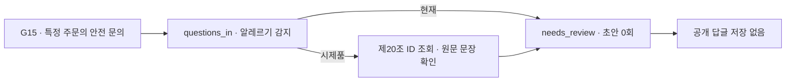

# 규정은 찾았는데 왜 답글은 보류됐을까

2026-11-13 · 오지 레스토랑 LangChain·LangGraph 스터디 · 기준 코드 `c24a37b`

**43/44에서 빠진 G15는 검색 전에 매장 확인으로 보낸 건입니다.** 제20조는 Chroma·BM25·RRF에서 각각 2위였습니다. 원문만 찾아 검토 상태에 보존하는 시제품에서는 **근거 확보 44/44, 자동 저장 43/44**가 나왔습니다. 이 구분을 쓰면 검색 성능과 처리 정책을 각각 개선할 수 있습니다.

## 한 질문이 지나가는 길

G15는 “땅콩 알레르기가 심한데 주문해도 안전해?”입니다. 교재 라벨은 제20조입니다. 제20조에는 같은 주방에서 조리해 미량 혼입 가능성을 완전히 없앨 수 없다는 규정이 있습니다. 특정 메뉴나 주문이 그 손님에게 안전하다고 판단할 때 필요한 현재 재료·조리·주문 기록은 이 규정집에 없습니다.



1. [`questions_in()`](../../app/services/policy_topics.py)의 `STAFF_ONLY`가 `알레르기`를 먼저 감지해 `((), "staff_only")`를 반환합니다. 이 분기는 알레르기 표시 위치처럼 규정으로 설명할 수 있는 질문에도 적용됩니다.
2. [`PolicySearch.retrieve()`](../../app/services/policy_search.py)는 조회할 조문과 후보를 비운 채 매장 확인을 표시합니다. 그래프의 `after_retrieval()`은 초안을 쓰기 전에 종료합니다. API는 `needs_review`, `reply=null`, `attempts=0`, `articleIds=[]`입니다.
3. 비교를 위해 호출한 **검색기 단독** 결과에서는 제20조가 35조와 155조 인덱스의 Chroma·BM25·RRF에서 모두 2위였습니다. 검색만 보면 이 질문에 필요한 조문은 이미 후보에 있었습니다. [50페이지 실험의 G15 원본](../scale/results/scale.json)
4. [시제품](allergy_handoff.py)은 직원 확인 상태를 유지하면서 제20조를 ID로 조회해 미량 혼입 안내 문장을 내부 그래프 상태에 넣습니다. 조문이 없거나 원문이 일치하지 않으면 근거 없는 보류로 남깁니다. 현재 API가 보류 상태에서 공개하는 `articleIds`는 빈 배열이므로 실제 직원 화면에서 원문을 보여 주려면 별도 조회·권한 계약이 필요합니다.

## 무엇을 실행했나

35조 인덱스와 기존 고정 문항 52개, 추가 진단 문항 8개를 현재 흐름과 시제품에서 문항별 3회씩 돌렸습니다. 실제 FastAPI 테스트 요청으로 답글의 저장 여부를 확인했습니다. 가짜 모델을 사용했고 실제 OpenAI 호출은 0회입니다. [문항별 원본](results/allergy-handoff.json)

| 측정 | 현재 흐름 | 내부 근거를 붙이는 시제품 |
| --- | ---: | ---: |
| 고정 세트에서 필요한 조문을 모두 확보 | 43/44 | 44/44 |
| 필요한 조문을 모두 표시해 답글 저장 | 43/44 | 43/44 |
| G15 초안 호출 | 0 | 0 |
| G15 공개 답글 저장 | 없음 | 없음 |
| 기존 매장 확인 문항 보류 | 7/7 | 7/7 |

- 추가 진단 문항 H01–H06은 알레르기 관련 표현입니다. 이 중 **5/6**에서 제20조 원문이 붙었고 6건 모두 보류했습니다. H05에는 파손과 알레르기가 함께 있어 제17·20조가 필요합니다. 시제품은 제20조만 붙여 **필수 조문 전체를 충족한 건 4/6**입니다. H06의 “견과류에 심한 반응”은 조문을 붙이지 못했습니다. 환불 상태 질문은 보류, 일반 칭찬은 저장이 계속 확인됐습니다.
- 인덱스가 없는 조건에서는 `staff_allergy_evidence_missing`과 보류가 관찰됐습니다. 시제품은 원문 일치 조건과 그래프 연결을 보는 실험입니다. 실제 직원 화면, 자동 안전 판단, 실제 메뉴 추천 품질은 이 시험에 포함되지 않습니다.

## 기존 연구에서 가져온 것과 아직 옮길 것

이번에는 제공된 Claude Artifact 8건의 저장 본문과 대응 Notion 스터디·회고의 관련 절을 코드·원시 결과에 다시 대조했습니다. 연구별 실제 모델 실험 전부를 같은 환경에서 재현한 범위까지는 포함되지 않습니다.

| 자료 | 현재 구현에서 확인한 것 | 이 실험에서 남은 것 |
| --- | --- | --- |
| 다중 의도 라우팅 | 알려진 복합 문의마다 근거를 확인합니다. | 문서가 제안한 별도 규정 검사는 미등록 주제와 안전 표현에도 필요합니다. 제20조가 현재 바로 보류되는 지점이 그 차이입니다. |
| 판정자의 신뢰성과 검증 사슬 | 제12·17·18조에 사건과 조건을 확인하는 코드 검사를 넣었습니다. | 자체 실험에서 근거 판정만으로 일부 답변 10개를 통과시켰습니다. 새 조문 평가에도 ‘질문의 각 조건을 다 다뤘나’를 둡니다. |
| 검색 방식과 평가, 온톨로지와 임베딩 | BM25·Chroma·RRF 후보와 안정적인 조문 ID를 구분합니다. | 본문에서 조건을 뒷받침하는 구절과 적용 버전을 함께 확인하는 평가가 필요합니다. |
| 세션 관리 설계 | 출처는 서버에서 읽고 리뷰별로 초안과 확정 결과를 관리합니다. | 직원이 읽을 자료에 조문 버전과 근거 문장을 붙여, 어떤 검토인지 리뷰 단위로 추적할 수 있습니다. |
| 에이전트 기억과 긴 컨텍스트 | 리뷰 원문·직전 답글·선호·규정의 출처를 분리합니다. | 후보 수와 프롬프트에 들어가는 문장 수를 독립적으로 측정합니다. |
| LangChain·LangGraph 교재와 에이전트 평가 | 그래프 종료와 저장 상태를 모두 확인합니다. | 개별 주장과 질문별 완전성, 예상 보류의 적절성을 따로 채점합니다. |
| 프로젝트 회고 | 환불 규정과 실제 환불 상태를 구분하고, 같은 문항을 반복합니다. | 시험 중 발견한 개별 상태의 오분류 4건과 역할별 확인 기준을 별도 평가 세트에 둡니다. |

기존 스터디 13절에서 후보 합집합·로컬 재정렬·질문 분리·Decisions SDK 모의 전송을 이미 실행했습니다. 이 작업은 **근거가 있어도 보류해야 하는 경우**와 **새 문서가 인덱스에 들어가도 라우터가 답변 경로에 연결하지 못하는 경우**를 직접 비교했습니다.

## 논문을 오지에 적용하는 방법

### 1. 근거 확보와 처리 결정을 각각 평가

- **Sufficient Context · ICLR 2025**는 정답을 뒷받침할 문맥의 충분성을 별도 라벨로 만들었습니다. 분류 평가용 115개에 질의의 단어가 들어가지만 답에는 충분하지 않은 문맥을 포함했습니다. 오지에서는 ‘제13조가 관련됨’과 ‘내 계좌에 환불이 들어갔는지 확인할 수 있음’을 다른 항목으로 평가합니다. [논문 §3–5](https://arxiv.org/html/2411.06037)
- **UAEval4RAG · ACL 2025**는 답할 수 없는 요청을 여섯 유형으로 나누고, 응답을 피한 비율과 대응이 적절한 비율을 나눴습니다. 오지에는 현재 기록 필요, 문서 밖 정책, 범위 충돌, 조건 불명, 일반 후기를 추가 진단으로 둡니다. 정당한 보류에 담당자가 확인할 정보가 있는지도 봅니다. [논문 §3–4](https://aclanthology.org/2025.acl-long.415/)
- **GRAB-RAG · AACL-IJCNLP 2026**은 같은 질문에 지지·약화·누락·오도 문맥을 넣었습니다. 3.8B–8B 소형 모델 세 종과 영어 QA 두 세트에서 보류를 지시해도 오도 문맥 질문의 41.6%에 답했습니다. 이 비율은 한국어 오지 서비스의 수치로 옮길 수 없습니다. 오지에서는 비슷한 절차를 설명하는 조문이나 이전 버전이 새 기준을 대신하지 않도록 정본의 ID·버전·적용 범위를 확인하고, 맞바꾼 기한을 시험합니다. [논문 §3, §5, Limitations](https://aclanthology.org/2026.aacl-long.153/)

### 2. 후보를 넓게 모으고 필요한 구절을 좁게 남김

- **LegalBench-RAG**는 6,858개 문항에 출처 구간을 붙여 필요한 텍스트를 얼마나 정확히 가져왔는지 재고, 자체 조합에서 일반 재정렬을 붙였을 때 성능이 낮아진 사례도 보고했습니다. 오지에서는 제20조 ID뿐 아니라 미량 혼입 문장이 있는지, 제49조는 ‘15분’이 예약 지연에 붙어 있는지까지 봅니다. [논문 §3, §5](https://arxiv.org/html/2408.10343v1)
- **Stage-Aware Decomposition · EMNLP Findings 2026**은 여러 조건을 동시에 만족해야 하는 검색에서 최초 질의를 조각내면 맥락을 잃을 수 있고, 후보 비교 단계에서 조건을 분리하면 도움이 됐다고 보고했습니다. 오지의 독립 FAQ 둘과 한 조문에 붙은 여러 적용 조건은 구조가 다릅니다. 원질문 후보를 보존하면서 누락된 문의만 추가 검색하는 방식을 먼저 비교합니다. [논문](https://aclanthology.org/2026.findings-emnlp.1644/)
- **Better Together · EMNLP Industry 2026**에서는 검색어 변형을 합친 효과가 데이터셋마다 달랐습니다. 기업 문서형 실험의 후보 합집합 이득과 모호한 질의 세트의 하락이 함께 보고됐습니다. 오지에서도 원질문, 조문 제목·동의어, 실패한 하위 질문을 각각 남겨 어디에서 근거가 추가되고 잡음이 늘었는지 계산합니다. [논문](https://aclanthology.org/2026.emnlp-industry.143/)
- **Contextual Retrieval**은 Anthropic 자체 실험에서 문맥 설명을 청크 앞에 붙인 임베딩과 BM25 조합이 상위 20개의 검색 실패율을 5.7%에서 2.9%로 줄였다고 보고했습니다. 오지는 이미 조문 제목을 인덱싱합니다. 추가 비교 변수는 장 제목, 적용 채널, 현재 규정 여부 같은 구조화 속성입니다. [Anthropic 실험 설정](https://www.anthropic.com/research/contextual-retrieval)

### 3. 초안 이후에는 주장과 저장 결과를 검증

- **RAGChecker · NeurIPS 2024**는 검색 모듈과 생성 모듈을 주장 단위로 따로 평가했습니다. 오지의 제12·17조 기한처럼 사건·숫자·조건을 붙여 단언 단위로 검사하고, 여러 질문 중 하나를 빠뜨린 초안은 완전성 검사에서 다룹니다. 52문항을 세 번 반복한 것은 실행 반복성입니다. 문장 형태가 다른 156문항의 품질 증거와 구별합니다. [논문 §3–4](https://proceedings.neurips.cc/paper_files/paper/2024/hash/27245589131d17368cccdfa990cbf16e-Abstract-Datasets_and_Benchmarks_Track.html)

## 설계 우선순위

1. **직원 확인에도 근거를 보존합니다.** 근거가 있었는지, 직원 확인이 필요한지, 답글을 저장했는지 세 값을 기록합니다. 제20조의 고정 원문과 확인해야 할 메뉴·조리 기록을 직원에게 보여 주는 경로가 첫 후보입니다. 알레르기 표시 위치와 특정 메뉴 안전 질문을 구분하고, 같은 리뷰의 파손 근거도 누락하지 않는지 확인합니다.
2. **새 조문은 검색 후보를 먼저 만들고, 문장이 답하는지 검증합니다.** 특정 조문을 연결하는 기존 경로를 빠른 경로로 사용합니다. 명확한 질문에서 기존 주제 규칙과 어긋나거나 답이 빠지면 문서 목록을 검색해 가능한 후보를 모읍니다. 예를 들어 “지하 주차장에서 휠체어로 올라가는 길”에는 제4조의 주차 요금과 제36조의 승강기 조건을 대조합니다. 규칙만 계속 추가하는 방법은 정확한 통제에 유리하고, 조문마다 코드 수정이 필요합니다. 검색으로 후보를 여는 방법은 확장에 유리하며, 정본·구절 검증과 정당한 보류를 함께 설계해야 합니다.
3. **일반 규정과 실시간 상태를 구별합니다.** 대기 순번, 실제 환불 입금, 주차 등록, 지갑 습득 여부는 실제 기록이 필요합니다. 답할 수 있는 경우에도 기록 조회에 필요한 권한과 확인 조건을 따로 둡니다. “관리자 암호”와 “손님용 와이파이 비밀번호”는 대상이 다릅니다. 유사도 점수가 높더라도 같은 자료로 처리할 수 없습니다.
4. **비슷한 문구와 여러 조건을 시험합니다.** 제18·82조처럼 주류 현장 판매와 배달 금지를 언급하는 두 조문, 제12·17·84조처럼 서로 다른 사고 규정을 가리키는 조문, 원조문 네 개가 필요한 문의를 넣습니다. 원문 문장을 확인하고 필요한 경우 참조 조문을 따라갑니다. 프롬프트에는 필요한 조건만 넣고 조문 세 개 상한에 걸리는 경우의 처리를 따로 측정합니다.
5. **판정 모델은 코드로 판정하기 어려운 부분에 비교합니다.** 조문 ID·숫자·출처·보류 결정을 코드가 확인하고, 모델은 어떤 조건이 빠졌는지와 자유 문장에 근거 없는 주장이 있는지를 봅니다. 기존 구조화 검토, Decisions API, 작은 로컬 검토 모델을 같은 라벨과 프롬프트 예산에서 비교할 수 있습니다. 이번 시제품에는 실제 모델 판정 품질이나 비용 수치가 없습니다.

다음 실험의 분모는 <b>규정만으로 답할 수 있는 문의</b>, <b>참고 조문이 있지만 실제 상태 확인이 필요한 문의</b>, <b>근거 자체가 없는 문의</b>입니다. 각각 필수 원문 확보·완전 답변 저장, 올바른 보류·근거 첨부, 잘못 저장한 비율을 봅니다. 새 문항은 개발용과 평가용으로 분리하고 모델 품질을 볼 때는 사람 라벨을 먼저 고정합니다.

**스스로 확인하기.** 50페이지 실험에서 23/24가 검색 후보에 들었는데 0/24가 저장됐습니다. 정답 조문을 포함했는지와 실제 답글이 완성됐는지를 별도 지표로 두면 어디부터 고칠지 어떻게 달라질까요?

## 재현

제품 루트에서 기존 35조 인덱스를 준비한 뒤 실행합니다.

```powershell
uv run --locked python -m app.services.policy_index
uv run --locked python benchmark/experiments/allergy_handoff.py --output .local/benchmark/allergy-handoff.json
```

50페이지 규정집 확장 측정은 [별도 기록](../scale/RESULTS.md)에 있습니다.
