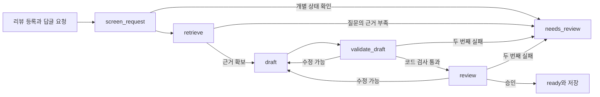

# 200페이지 규정 답글의 LangGraph 재설계

동일한 규정과 평가 문항에서 조문을 빠뜨린 답글과 실제 상태를 확인하지 않고 승인한 답글이 어느 단계에서 줄어드는지 확인합니다. 코드 기준점은 `062c92a`, 최초 모델 실행 소스는 `c6652e5`입니다. 32문항과 605개 조문의 원문 및 벡터를 고정합니다.

## 기준 실행에서 확인한 문제

기준 실행에서 M01은 제2조와 제6조를 전달해 영업시간을 설명하는 제1조를 놓쳤습니다. H01은 매장의 적립 기록을 확인해야 하는 문의였습니다. 질문별로 근거를 모으고 개별 거래 확인을 작성 전에 분기하도록 흐름을 바꿨습니다. 초안 검사의 조문 ID와 필수 안내는 코드가 확인하고, 적용 조건의 의미는 모델이 검토합니다. [기준 실험](RESULTS_200.md) · [재설계 결과](REDESIGN_RESULTS_200.md)

## 비교한 대안

| 대안 | 이점 | 한계 |
| --- | --- | --- |
| 기존 규칙과 프롬프트에 두 문의의 표현을 추가 | 변경이 작고 회귀를 확인하기 쉬움 | 복합 문의를 한 항목으로 간주하는 흐름과 검색·승인의 책임이 그대로 남음 |
| 독립 직원 확인과 질문별 근거, 코드 검사 후 모델 검토 | 근거가 빠진 위치를 트레이스에서 관찰하며, 기존 모델 호출 한도와 상태 계약 사용 | 질문 분리는 한국어 표현과 문서 범위에 의존하며 검색 호출이 늘 수 있음 |
| 구조화 LLM 라우터·재순위 모델, 또는 규정집 전체를 캐시해 제공 | 표현이 다양한 문의를 의미로 나누거나 넓게 근거를 읽을 수 있음 | 추가 추론 비용과 출력 변동, 장문 후보에서 적용 범위를 잘못 고를 가능성, 사용 모델과 비용 비교의 변경 |

[해석] 두 번째 대안을 적용합니다. 주문 DB나 매장 실시간 상태를 연결하는 경우에는 별도 인증과 조회 결과가 직원 확인 노드의 새로운 입력이 됩니다. 현재 연구는 읽기 전용 합성 규정과 답글 저장까지를 다룹니다. [LangGraph Workflows and agents](https://docs.langchain.com/oss/python/langgraph/workflows-agents) · [LangSmith 단계·경로·최종 응답 평가](https://docs.langchain.com/langsmith/evaluate-complex-agent)

## 요청 하나가 지나가는 경로

- `screen_request`는 실제 적립, 환불 입금, 인계·설치처럼 기록이나 현장 확인이 필요한 문의를 초안 전에 보류합니다. `retrieve`는 나뉜 문의에서 등록된 사건 규칙과 해당 절의 검색 결과를 사용합니다. 검색이 근거를 빠뜨리면 표현을 정리해 한 번 다시 찾고, 질문 범위와 일치하는 조문 간 명시적 참조를 한 단계 확인합니다.
- 매장 포장 수령의 제69조가 벡터·BM25 후보에서 빠져도, 제201조의 차량 픽업 설명 뒤에 있는 ‘매장 안 포장 수령은 제69조를 적용한다’를 확인할 수 있습니다. 제69조 원문이 검증을 통과하면 그 조문을 초안에 전달합니다. 실행 중에는 문의와 규정 본문을 사용합니다.
- `validate_draft`는 근거 ID, 사고의 필수 안내, 직원 후속 확인 표시, 승인 전 보상 약속을 검사합니다. `review`는 질문과 조문을 함께 보고 의미를 검토합니다. 검토에 실패하면 같은 근거로 한 번 더 쓰고 최대 두 번 작성합니다. 기존 API 서비스는 승인된 답글을 저장합니다. [LangGraph Graph API](https://docs.langchain.com/oss/python/langgraph/graph-api)

## 비교 조건

양쪽 환경에서 문항 ID, 정답, 임베딩, 모델 ID, 캐시 설정, 모델 시간 제한, 반복 수, 평가 함수를 고정합니다. `k=1`, `k=3`은 기존 교재 평가 경로로 재측정합니다. 전체 API는 같은 제출 입력으로 새 코드에서 등록·작성·검토·저장·재조회를 실행합니다. 각 실험에 기존과 다른 실행 이름을 붙이고 같은 LangSmith 데이터셋에 등록합니다. 요청 횟수와 세 번 모두 통과한 문항, 오승인, HTTP 오류, 지연, 요청에 보고된 비용을 남깁니다. [Anthropic 에이전트 평가](https://www.anthropic.com/research/demystifying-evals-for-ai-agents)
